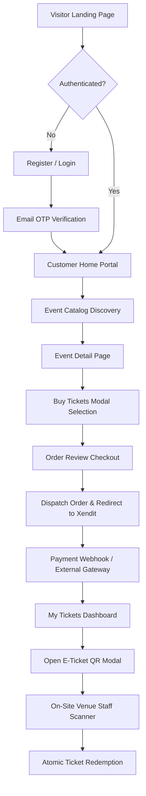
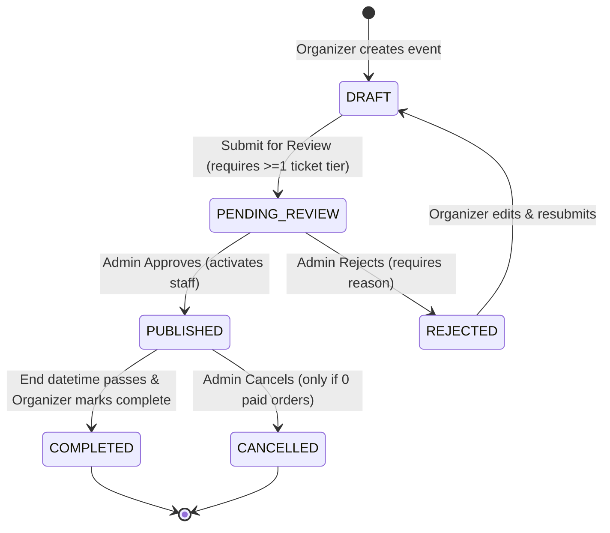
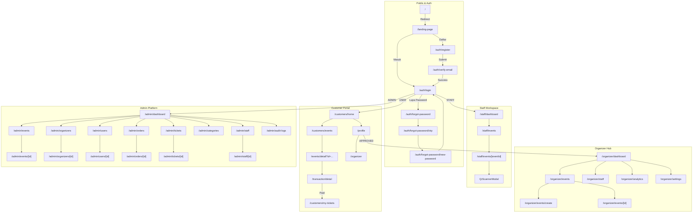

# Frontend System Documentation: Tixora / Festix

This document serves as the comprehensive technical specification and functional blueprint of the Festix (`festix-fe`) frontend web application. It is designed to enable another developer or AI system to reproduce the entire application architecture, user flows, business logic, role-based access rules, state transitions, and API integration contracts independently of visual styling or backend implementation.

---

## A. Application Overview

### 1. Purpose and Domain
**Festix** (branded in user-facing views as **Tixora.**) is an event ticketing and attendance management platform. It facilitates the discovery, purchasing, issuance, and redemption of electronic event tickets, alongside dedicated workspaces for event organizers, venue operational check-in staff, and platform administrators.

### 2. User Roles and Actors
The application defines five operational roles:
1. **Public Guest (Unauthenticated):** Browses public landing pages, explores active events, filters categories, and views public event details. Must register or authenticate to purchase tickets or apply as an organizer.
2. **Customer / Regular User (`USER`):** Authenticated account. Can update personal profile details, change passwords, submit ticket purchase orders via integrated payment gateways (Xendit), view personal ticket inventory with dynamically generated QR codes, download ticket passes as image assets, and apply for organizer status.
3. **Event Organizer (`USER` with approved `OrganizerProfile`):** Authorized event creators. Can access the Organizer Workspace to manage event lifecycles (Draft, Submit for Review, Published, Completed), configure tiered ticket classes, monitor real-time sales and revenue, invite and assign operational staff, and view live attendee check-in progress.
4. **Operational Staff (`STAFF` or `ADMIN`):** On-site venue crew. Accesses the Staff Workspace to view assigned events, scan attendee ticket QR codes via hardware camera/webcam or manual code entry, validate ticket authenticity against schedule and status constraints, and record atomic ticket redemptions.
5. **Platform Administrator (`ADMIN`):** System operator. Has global oversight across all system entities via the Admin Platform: audits user accounts, modifies system roles, suspends/unsuspends users, inspects and approves organizer applications and business legal documents, audits and approves/rejects/cancels submitted events, reviews orders and issued tickets (read-only), manages event categories (CRUD), assigns staff to events, and monitors immutable audit logs.

### 3. High-Level Frontend Architecture
- **Framework:** Next.js (App Router, Turbopack, React 19, TypeScript).
- **Styling & UI:** Tailwind CSS, Radix UI / Shadcn UI primitive abstractions (`@base-ui/react`, `@tailwindcss/postcss`), Lucide icons, Sonner toast notifications, Recharts.
- **Client State & Cookie Management:** Client-side React state (`useState`, `useReducer`, `useEffect`, `useMemo`), synchronized with `js-cookie` (`token`) for authentication persistence.
- **Client Utilities:** `html5-qrcode` for camera video feed scanning, `qrcode` for QR canvas/data URL generation, `html-to-image` for generating downloadable PNG passes.
- **Backend Communication:** REST API consumption via `fetch` client utilities (`auth-api.ts`, `organizer-api.ts`, `staff-api.ts`, `admin-api.ts`, domain-specific APIs). Configured via `process.env.NEXT_PUBLIC_API_URL` (exported from root `api.ts`, defaults to `http://localhost:8000`).
- **Authentication Protocol:** JSON Web Tokens (JWT) transmitted as HTTP Bearer tokens via `Authorization: Bearer <token>` request headers. Expiry defaults to 1 day on login. Token invalidation (401 response) triggers automatic cookie purge and login redirection.

---

## B. Complete Route & Page Inventory

| Route | Page / File Location | Role | Access Type | Layout | Purpose | Main Features | Navigation Ingress |
|---|---|---|---|---|---|---|---|
| `/` | `src/app/page.tsx` | All | Public | Root | Entry redirect | Instant redirect to `/landing-page` | Direct root access |
| `/landing-page` | `src/app/landing-page/page.tsx` | Guest / All | Public | Root | Marketing & discovery landing page | Hero banner, popular event showcase, category browse, value propositions, upcoming events, how it works, CTA footer | Direct URL, Root redirect, Navbar logo |
| `/customers/home` | `src/app/customers/home/page.tsx` | Authenticated / Guest | Public / Customer | Root | Authenticated customer home portal | Interactive search bar, quick category filter pills, featured upcoming events, popular events carousel | Navbar "Home" / "Masuk ke App" |
| `/customers/events` | `src/app/customers/events/page.tsx` | All | Public / Customer | Root | Search & event catalog exploration | Multi-criteria filter sidebar (categories, price types, price range, date picker range), sort dropdown, search bar, active filter pills, event grid | Navbar "Events" / "Jelajahi Event", Hero search submit |
| `/events/[id]` | `src/app/events/[id]/page.tsx` | All | Public | Root | Event slug redirect proxy | Redirects to `/events/detail?id=<id>` | External event links, Card click |
| `/events/detail` | `src/app/events/detail/page.tsx` | All | Public | Root | Comprehensive event detail view | Hero poster, schedule, location, refund status, description, venue layout map, ticket tiers, Buy Ticket modal trigger | Event cards, catalog clicks |
| `/event/detail` | `src/app/event/detail/page.tsx` | All | Public | Root | Singular alias for event detail | Equivalent to `/events/detail` | Alternate link alias |
| `/transaction/detail` | `src/app/transaction/detail/page.tsx` | Customer (`USER`, `STAFF`, `ADMIN`) | Protected | Root | Order review & checkout confirmation | Itemized order breakdown, total calculation, idempotency key generation, Xendit payment link dispatch | "Lanjut ke Review Pesanan" from Buy Tickets modal |
| `/customers/my-tickets` | `src/app/customers/my-tickets/page.tsx` | Customer (`USER`, `STAFF`, `ADMIN`) | Protected | Root | Order & digital ticket management | Order status tabs (All, Pending, Paid, Expired/Failed), transaction search, external payment resumption, QR modal trigger | Navbar "Tiket Saya", Post-checkout redirect |
| `/profile` | `src/app/profile/page.tsx` | Customer / Organizer / Admin | Protected | Root | Account profile & security settings | Avatar & name editing modal, password update modal (via current password or OTP), Organizer status CTA, sign out | Navbar "Profil", User dropdown |
| `/customers/profile` | `src/app/customers/profile/page.tsx` | - | Incomplete | Root | Abandoned customer profile route | Returns `null` (Dead route / UI stub) | Unlinked |
| `/organizer` | `src/app/organizer/page.tsx` | Customer (`USER`) | Protected | Root | Organizer application form | Multi-step form (Company details, Bank info, SIUP/Guarantee/Registration/KTP document uploads), status alert | Profile "Jadi Organizer", Navbar "Untuk Organizer" |
| `/auth/login` | `src/app/auth/login/page.tsx` | Guest | Public (Guest) | Root | Account login | Email & password inputs, unverified email redirection, role-based landing redirection | Navbar "Masuk", Auth prompts |
| `/auth/register` | `src/app/auth/register/page.tsx` | Guest | Public (Guest) | Root | Account registration | Real-time 5-rule password security check, scroll-locked Terms & Privacy modals, auto-redirect to OTP verification | Navbar "Daftar", Login link |
| `/auth/verify-email` | `src/app/auth/verify-email/page.tsx` | Guest | Public (Guest) | Root | Email registration OTP verification | 6-digit numeric OTP input, 5-minute countdown timer, expired state fallback to register | Post-registration, Unverified login redirect |
| `/auth/forgot-password` | `src/app/auth/forgot-password/page.tsx` | Guest | Public (Guest) | Root | Password reset initiation | Email input to request password reset OTP | Login "Lupa Password?" |
| `/auth/forgot-password/otp` | `src/app/auth/forgot-password/otp/page.tsx` | Guest | Public (Guest) | Root | Reset password OTP verification | 6-digit OTP code, 15-minute countdown timer, resend OTP trigger | Post-forgot password submission |
| `/auth/forgot-password/new-password` | `src/app/auth/forgot-password/new-password/page.tsx` | Guest | Public (Guest) | Root | New password creation | Password & confirmation inputs (minimum 8 chars), submits reset to backend | Post-OTP verification |
| `/staff/dashboard` | `src/app/staff/dashboard/page.tsx` | Staff (`STAFF`, `ADMIN`) | Role Restricted | `StaffLayout` | Staff operational overview | Assigned events counter, paid ticket volume, redeemed counter, arrival rate %, quick QR scanner trigger, assigned event cards | Login redirect for `STAFF`, Staff sidebar |
| `/staff/events` | `src/app/staff/events/page.tsx` | Staff (`STAFF`, `ADMIN`) | Role Restricted | `StaffLayout` | Assigned events list | Search bar, status badges, redemption progress bar, links to event redemption dashboard | Staff sidebar "My Events" |
| `/staff/events/[eventId]` | `src/app/staff/events/[eventId]/page.tsx` | Staff (`STAFF`, `ADMIN`) | Role Restricted | `StaffLayout` | Event check-in command & monitor | Real-time event statistics, attendance progress bar, recent redemptions log, direct scanner launch | Event card "Manage Event" |
| `/organizer/dashboard` | `src/app/organizer/(workspace)/dashboard/page.tsx` | Organizer (`APPROVED`) | Role Restricted | `OrganizerWorkspaceLayout` | Organizer command center | Gross revenue, tickets sold, published events, check-in count, action items (rejected/drafts), upcoming events, live sales feed | Login redirect for approved organizers, Sidebar |
| `/organizer/events` | `src/app/organizer/(workspace)/events/page.tsx` | Organizer (`APPROVED`) | Role Restricted | `OrganizerWorkspaceLayout` | Organizer event catalog | Status tabs (All, Published, Completed, Draft, Pending, Rejected, Cancelled), search, pagination, Submit for Review, Mark as Completed | Organizer sidebar "My Events" |
| `/organizer/events/create` | `src/app/organizer/(workspace)/events/create/page.tsx` | Organizer (`APPROVED`) | Role Restricted | `OrganizerWorkspaceLayout` | 5-Step event creation wizard | Step 1 (Basics & images), Step 2 (Schedule & location), Step 3 (Ticket classes), Step 4 (Team invitations), Step 5 (Review, Draft save / Submit) | Organizer sidebar "Create Event", Dashboard CTA |
| `/organizer/events/[id]` | `src/app/organizer/(workspace)/events/[id]/page.tsx` | Organizer (`APPROVED`) | Role Restricted | `OrganizerWorkspaceLayout` | 5-Tab comprehensive event workspace | Tab 1 (Overview, status alerts, mark complete), Tab 2 (Ticket tiers CRUD), Tab 3 (Crew roster & removal), Tab 4 (Check-in monitor), Tab 5 (Tier revenue analytics) | Event card click, Creation redirect |
| `/organizer/staff` | `src/app/organizer/(workspace)/staff/page.tsx` | Organizer (`APPROVED`) | Role Restricted | `OrganizerWorkspaceLayout` | Cross-event staff roster | Filter tabs (All, Active, Pending), search bar, event links, member details | Organizer sidebar "Staff & Invitations" |
| `/organizer/analytics` | `src/app/organizer/(workspace)/analytics/page.tsx` | Organizer (`APPROVED`) | Role Restricted | `OrganizerWorkspaceLayout` | Organizer financial analytics | Gross volume, tickets issued, capacity fill rate, on-site check-ins, event-by-event performance table | Organizer sidebar "Analytics" |
| `/organizer/settings` | `src/app/organizer/(workspace)/settings/page.tsx` | Organizer (`APPROVED`) | Role Restricted | `OrganizerWorkspaceLayout` | Organization profile & banking | Verified company name, phone, address, NIK, bank name, account number, beneficiary, approved documents | Organizer sidebar "Settings" |
| `/admin/dashboard` | `src/app/admin/dashboard/page.tsx` | Admin (`ADMIN`) | Role Restricted | `AdminLayout` | Platform executive dashboard | Summary cards (users, organizers, events, tickets, orders, revenue), monthly revenue chart, order status distribution, ticket status snapshot, recent events/orders | Login redirect for `ADMIN`, Admin sidebar |
| `/admin/events` | `src/app/admin/events/page.tsx` | Admin (`ADMIN`) | Role Restricted | `AdminLayout` | Platform event curation | Search, status filters (All, Pending, Published, Draft, Rejected, Cancelled), paginated table, event review link | Admin sidebar "Events" |
| `/admin/events/[id]` | `src/app/admin/events/[id]/page.tsx` | Admin (`ADMIN`) | Role Restricted | `AdminLayout` | Admin event review & actions | Event details, cover image, ticket tiers, approve event action, reject event modal with reason, cancel event modal with reason | Event row eye icon |
| `/admin/organizers` | `src/app/admin/organizers/page.tsx` | Admin (`ADMIN`) | Role Restricted | `AdminLayout` | Organizer application review table | Search, status filters (All, Pending, Approved, Rejected), paginated table, link to application detail | Admin sidebar "Organizers" |
| `/admin/organizers/[id]` | `src/app/admin/organizers/[id]/page.tsx` | Admin (`ADMIN`) | Role Restricted | `AdminLayout` | Application & legal document review | Organization info, applicant details, banking info, individual document approval/rejection with reason, master organizer approval/rejection | Organizer row eye icon |
| `/admin/users` | `src/app/admin/users/page.tsx` | Admin (`ADMIN`) | Role Restricted | `AdminLayout` | User account directory | Search, role filters (All, User, Staff, Admin), paginated table, suspension status badge, detail link | Admin sidebar "Users" |
| `/admin/users/[id]` | `src/app/admin/users/[id]/page.tsx` | Admin (`ADMIN`) | Role Restricted | `AdminLayout` | User profile & security governance | Profile details, linked organizer profile, activity counts, change role dialog (`USER`, `STAFF`, `ADMIN`), suspend/unsuspend dialogs with reason | User row eye icon |
| `/admin/orders` | `src/app/admin/orders/page.tsx` | Admin (`ADMIN`) | Role Restricted | `AdminLayout` | Platform orders ledger (Read-Only) | Search, payment status filters (All, Paid, Pending, Expired, Failed), paginated table, order detail link | Admin sidebar "Orders" |
| `/admin/orders/[id]` | `src/app/admin/orders/[id]/page.tsx` | Admin (`ADMIN`) | Role Restricted | `AdminLayout` | Order detail inspection (Read-Only) | Customer info, payment method, gateway transaction session ID, itemized lines, linked issued tickets | Order row eye icon |
| `/admin/tickets` | `src/app/admin/tickets/page.tsx` | Admin (`ADMIN`) | Role Restricted | `AdminLayout` | Issued ticket ledger (Read-Only) | Search, redemption status filter (All, Unredeemed, Redeemed, Cancelled), paginated table, ticket detail link | Admin sidebar "Tickets" |
| `/admin/tickets/[id]` | `src/app/admin/tickets/[id]/page.tsx` | Admin (`ADMIN`) | Role Restricted | `AdminLayout` | Electronic ticket inspection (Read-Only) | Ticket code, event info, tier info, price, order link, customer info, redemption timestamp | Ticket row eye icon |
| `/admin/categories` | `src/app/admin/categories/page.tsx` | Admin (`ADMIN`) | Role Restricted | `AdminLayout` | Event category management (CRUD) | Search, table with associated event counts, create category modal, edit category modal, delete category confirmation | Admin sidebar "Categories" |
| `/admin/staff` | `src/app/admin/staff/page.tsx` | Admin (`ADMIN`) | Role Restricted | `AdminLayout` | Staff directory & scanner access | Search, paginated table, assigned event counts, staff detail link | Admin sidebar "Staff" |
| `/admin/staff/[id]` | `src/app/admin/staff/[id]/page.tsx` | Admin (`ADMIN`) | Role Restricted | `AdminLayout` | Staff event assignment workspace | Profile info, assigned events roster, assign staff to event dialog (UUID input), remove staff assignment confirmation | Staff row eye icon |
| `/admin/audit-logs` | `src/app/admin/audit-logs/page.tsx` | Admin (`ADMIN`) | Role Restricted | `AdminLayout` | System security audit trail | Search, paginated table, action badges, inspect detail dialog with raw formatted JSON metadata | Admin sidebar "Audit Logs" |

---

## C. Detailed Page-by-Page Breakdown

### 1. Root & Marketing Pages

#### 1.1 Root Proxy (`/`)
- **Page Identity:** `src/app/page.tsx`. Public. Intended for all visitors.
- **Page Structure:** Server component without DOM rendering.
- **Available Features:** Executes server-side redirect `redirect("/landing-page")`.
- **Data Dependencies:** None.
- **UI States:** Immediate redirect.
- **Navigation Behavior:** Redirects HTTP requests directly to `/landing-page`.

#### 1.2 Landing Page (`/landing-page`)
- **Page Identity:** `src/app/landing-page/page.tsx`. Public. Default unauthenticated entry page.
- **Page Structure:**
  - `Navbar` (fixed header with scroll blur detection).
  - `HeroSection` (visual tagline, call-to-action buttons).
  - `FeaturedEvents` (horizontal carousel of high-demand events).
  - `ExploreEvents` (event cards grid with category navigation).
  - `WhyTixora` (platform value propositions: verified tickets, instant QR delivery, secure payments).
  - `UpcomingEvents` (date-sorted list of forthcoming events).
  - `HowItWorks` (3-step explainer for ticket buyers).
  - `CtaSection` (promotional banner encouraging account registration).
  - `HomeFooter` (legal links, branding, social handles).
- **Available Features:**
  - Browse featured and popular events.
  - Interactive navigation to event detail views.
  - Authenticated user detection via cookie `token` and `getMe()`. If logged in, Navbar shows "Masuk ke App" button leading to `/customers/home` and conditional "Admin" button leading to `/admin/dashboard`.
- **Data Dependencies:**
  - Parallel SSR fetch: `GET /events`, `GET /events/most-popular`, `GET /categories` (`cache: "no-store"`).
- **UI States:**
  - Loading: Rendered on server.
  - Error: Throws `"Failed to fetch landing page data"` if any of the three endpoints fail.
- **Navigation Behavior:** Clicking event cards routes to `/events/detail?id=<id>`. "Jelajahi Event" routes to `/customers/events`. "Untuk Organizer" routes to `/organizer`. "Masuk" routes to `/auth/login`. "Daftar" routes to `/auth/register`.

---

### 2. Customer & Discovery Portal

#### 2.1 Customer Home Portal (`/customers/home`)
- **Page Identity:** `src/app/customers/home/page.tsx` (rendering `HomePage`). Public/Customer.
- **Page Structure:**
  - `HomeNavbar`: sticky header with brand logo, links (`Home`, `Events`, `Wishlist`, `Tiket Saya`), profile link, and conditional Admin shortcut if `user.role === "ADMIN"`.
  - `HomeHero`: search input box with submit button.
  - `EventCategories`: horizontal pill list (`All`, `Hajatan`, `Konser`, `Pameran`, `Seminar`, `Workshop`).
  - `FeaturedEvents`: 3 upcoming events matching the selected category.
  - `PopularEvents`: popular events excluding the featured 3.
  - `HomeFooter`.
- **Available Features:**
  - Search submission: typing query and pressing Enter/Submit redirects to `/customers/events?search=<query>`.
  - Category filtering: client-side filtering between `All` and specific event categories.
  - Event date filtering: client-side filter excluding events where `status !== "PUBLISHED"` or `new Date(endDatetime) <= new Date()`.
- **Data Dependencies:**
  - Client-side parallel fetch: `GET /events`, `GET /events/most-popular`.
  - Auth check: `getMe()` for navbar role display.
- **UI States:**
  - Initial/Loading: Centered loading spinner.
  - Empty: Empty sections displayed gracefully if no events match criteria.
  - Error: Network errors silently caught, falling back to empty list.
- **Navigation Behavior:** Clicking event card navigates to `/events/detail?id=<id>`.

#### 2.2 Event Exploration & Catalog (`/customers/events`)
- **Page Identity:** `src/app/customers/events/page.tsx` (rendering `EventsPage` wrapped in Suspense). Public/Customer.
- **Page Structure:**
  - Header: Explore tagline, title, and search input.
  - Main Grid: 2-column layout (Desktop filter sidebar 280px + Results area).
  - Mobile Filter Sheet: slide-over drawer for mobile screen viewports.
  - `EventsToolbar`: total count display, active filter tags with remove buttons, sort dropdown (`Recommended`, `Price: Low to High`, `Price: High to Low`, `Date: Earliest First`), and mobile filter toggle button.
  - `EventsGrid`: responsive grid of `EventDiscoverCard` components.
- **Available Features:**
  - Text search: searches across `title` and `location`.
  - Category filter: multi-category checkbox selection (OR logic).
  - Price type filter: `All`, `Free` (`price === 0`), `Paid` (`price > 0`).
  - Price range: min/max numeric inputs.
  - Date range: calendar picker supporting single date or start-to-end ranges.
  - URL Synchronization: all filters synchronize bidirectional query parameters (`search`, `category`, `priceType`, `minPrice`, `maxPrice`, `from`, `to`).
  - Active filter tags: individually removable badges for every active filter parameter.
  - Clear all filters button.
- **Data Dependencies:**
  - Client fetch: `GET /events`. Transformed via `mapBackendEvent` in `src/lib/event-types.ts`.
- **UI States:**
  - Loading: Skeleton card grid.
  - Error: Error container with "Try Again" retry button triggering `fetchEvents`.
  - Empty: "No matching events found" state with "Clear Filters" button.
- **Navigation Behavior:** Clicking event card navigates to `/events/detail?id=<id>`.

#### 2.3 Event Detail Page (`/events/detail`, `/event/detail`, `/events/[id]`)
- **Page Identity:** `src/app/events/detail/page.tsx` & `src/app/event/detail/page.tsx` (rendering `EventDetailContent`), aliased from `/events/[id]`. Public/Customer.
- **Page Structure:**
  - Breadcrumb navigation: `Beranda > Events > <Category> > <Event Title>`.
  - Hero Poster Banner: cover image, category badge, share button, event title, organizer verification pill, starting price pill.
  - Schedule Card: weekday name, full date, start time in WIB.
  - Venue Card: location address with venue label.
  - Guarantee Pills: refund eligibility pill, QR verification guarantee pill.
  - Description Section: full multiline event description.
  - Venue Layout Section: displays `venueImageUrl` if uploaded by organizer.
  - Guidelines Section: admittance rules, prohibited items, check-in instructions.
  - Ticket Classes Sidebar (Sticky): list of ticket tiers with name, price in IDR, availability badge (`Tersedia` vs `Habis`), and "Beli Tiket" action button.
  - Organizer Card: organizer name, avatar initial, verified badge.
  - `BuyTicketsModal`: modal allowing ticket category selection and quantity adjustment.
  - `LoginPromptDialog`: modal triggered if unauthenticated user clicks "Beli Tiket".
- **Available Features:**
  - Share Event: copies current URL to clipboard with confirmation toast.
  - Buy Ticket Trigger: checks for cookie `token`. If absent, opens `LoginPromptDialog` prompting login or continuation of browsing. If present, opens `BuyTicketsModal`.
  - Ticket Quantity Configuration (Inside Modal): increment/decrement per tier (maximum 10 per tier, capped by available quota), dynamic total price recalculation.
  - Checkout Hand-off: clicking "Lanjut ke Review Pesanan" encodes selected tier IDs and quantities into URL query parameters and navigates to `/transaction/detail?eventId=<id>&items=<encodedJSON>`.
- **Data Dependencies:**
  - Client fetch: `GET /events/<eventId>`.
- **UI States:**
  - Loading: `EventDetailSkeleton` with animated skeleton placeholders.
  - Missing ID Error (`NO_ID`): Alert box with button to return to home.
  - Not Found Error (`NOT_FOUND`): 404 message indicating event is unavailable or unpublished.
  - Network Error (`SERVER_ERROR` / `NETWORK_ERROR`): Error prompt with "Coba Lagi" reload button.
  - Sold Out State: "Beli Tiket" button hidden if all tiers have `availableQuota === 0`. Individual sold out tiers disable counter buttons.
- **Navigation Behavior:** Back buttons lead to `/customers/home`. Login dialog redirects to `/auth/login`. Checkout button routes to `/transaction/detail`.

#### 2.4 Transaction Checkout Review (`/transaction/detail`)
- **Page Identity:** `src/app/transaction/detail/page.tsx` (rendering `TransactionDetailContent`). Protected (`USER`, `STAFF`, `ADMIN`).
- **Page Structure:**
  - Header: Back button to event detail, title "Review Pesanan".
  - Left Column (Order Items):
    - Event summary card (cover thumbnail, title, date, time, location).
    - Ticket details card (itemized tier names, quantity multipliers, line totals).
    - Payment security notice (Xendit gateway information).
  - Right Column (Sticky Order Summary):
    - Subtotal calculation per tier.
    - Total ticket count.
    - Grand total in IDR.
    - "Konfirmasi & Bayar" action button with loading spinner.
    - Terms acknowledgement note.
- **Available Features:**
  - URL Parameter Validation: parses `eventId` and `items` array `[{ ticketTypeId, quantity }]`. Validates format and ensures non-empty selection.
  - Real-Time Quota Verification: compares requested quantities against fetched event available quotas. Rejects checkout if quota is exceeded.
  - Idempotent Order Dispatch: generates unique `idempotencyKey` formatted as `${eventId}-${Date.now()}-${randomString}` to prevent double charges on rapid clicks.
  - Gateway Redirection: sends `POST /orders` with Bearer token. On receipt of `paymentUrl`, opens Xendit invoice in a new browser tab (`window.open(paymentUrl, "_blank")`) and redirects current tab to `/customers/my-tickets`.
- **Data Dependencies:**
  - Client fetch: `GET /events/<eventId>`.
  - Client dispatch: `POST /orders` with body `{ items: [{ ticketTypeId, quantity }], idempotencyKey }`.
- **UI States:**
  - Loading: Animated skeleton placeholders for left and right columns.
  - Validation Errors:
    - Missing Event / Invalid Selection: Amber alert box with back link.
    - Tickets Unavailable / Sold Out: Destructive alert indicating tickets are no longer available.
  - Submitting: Button disabled, shows spinner "Memproses Pembayaran...". Double submission guarded by `useRef`.
- **Navigation Behavior:** Back button returns to `/events/detail?id=<eventId>`. Successful dispatch routes to `/customers/my-tickets`.

#### 2.5 My Tickets & Order Management (`/customers/my-tickets`)
- **Page Identity:** `src/app/customers/my-tickets/page.tsx` (rendering `MyTicketsContent`). Protected (`USER`, `STAFF`, `ADMIN`).
- **Page Structure:**
  - Header: "Tiket Saya" title, refresh status button (`Perbarui Status`).
  - Metrics Strip: Total Orders, Awaiting Payment (`PENDING`), Tickets Issued count.
  - Filter Tabs: `Semua`, `Menunggu Bayar`, `Sudah Bayar`, `Kedaluwarsa`.
  - Search Input: searches across order numbers, event titles, and tier names.
  - Order Cards List:
    - Order top bar: order number, creation date, status badge (`Pembayaran Berhasil`, `Menunggu Pembayaran`, `Kedaluwarsa`, `Gagal`).
    - Event overview: cover image, title, schedule, location, tier chips, order total in IDR.
    - Conditional State Blocks:
      - Pending: "Lanjutkan Pembayaran" button linking externally to `order.paymentUrl`.
      - Expired/Failed: Explanation that ticket quota was automatically released.
      - Paid: List of individual issued electronic tickets with ticket code, redemption state, and "Buka E-Tiket" button.
  - `TicketDetailModal`: digital ticket pass modal with QR code and download capabilities.
- **Available Features:**
  - Status Filter Tabs: filters orders by lifecycle status.
  - Expiration Calculation: evaluates order expiration dynamically on the client by comparing `order.expiresAt` against `Date.now()`. Orders marked `PENDING` whose expiry time has passed automatically transition to the `Kedaluwarsa` tab.
  - Payment Resumption: allows reopening the Xendit payment link for active pending orders.
  - Status Polling / Refresh: "Perbarui Status" button re-fetches latest order and ticket records from backend.
  - Digital Ticket Modal: clicking "Buka E-Tiket" opens the ticket inspection dialog.
  - E-Ticket Pass Download: inside modal, renders the styled ticket pass into a PNG file via `html-to-image` (`toPng`) and triggers automatic browser download named `Tixora_<eventTitle>_<ticketCode>.png`.
  - Dynamic QR Code Generation: dynamically converts `ticket.ticketCode` to a high-density (level H) QR code canvas via `qrcode.toDataURL`.
- **Data Dependencies:**
  - Parallel client fetch: `GET /orders`, `GET /issued-tickets/my` (with Bearer token).
- **UI States:**
  - Loading: Animated card skeletons.
  - Refreshing: Refresh button spins without unmounting existing order list.
  - Error: Error container with "Coba Lagi" retry button.
  - Empty: Distinct contextual empty messages depending on active tab.
- **Navigation Behavior:** Unauthenticated access redirects to `/auth/login`. "Jelajahi Event Sekarang" button routes to `/customers/home`.

#### 2.6 User Profile & Account Settings (`/profile`)
- **Page Identity:** `src/app/profile/page.tsx` (rendering `ProfilePage`). Protected (`USER`, `ORGANIZER`, `ADMIN`).
- **Page Structure:**
  - `ProfileHeader`: user avatar, full name, role badge, user ID snippet, "Ubah Foto" file upload trigger.
  - `ProfileStats`: attendance metrics strip (Tickets, Wishlist, Events attended - UI mock).
  - `OrganizerCta`: contextual card based on organizer application status:
    - No application: "Punya event sendiri? Daftar sebagai organizer" with "Jadi Organizer" link.
    - Pending application: "Cek Status Pengajuan" button opening status dialog ("Under Review").
    - Rejected application: "Cek Status Pengajuan" button showing rejection reason and "Apply Again" button.
    - Approved application: "Buka Workspace Organizer" button linking to `/organizer/dashboard`.
  - `ProfileMenu`: list of settings links:
    - "Organizer Workspace" (displayed conditionally if user is an approved organizer).
    - "Personal Information" (triggers `PersonalInfoModal`).
    - "My Tickets" (links to `/customers/my-tickets`).
    - "Security" (triggers `SecurityModal`).
    - Dead links: "Payment Methods", "Notifications", "Preferences", "Help & Support".
  - `ProfileDangerZone`: "Sign out" button purging cookies and redirecting to root.
  - `PersonalInfoModal`: view account details or edit Full Name via `PATCH /auth/me`.
  - `SecurityModal`: change password via either Current Password verification or email OTP verification.
- **Available Features:**
  - Avatar Upload: uploads image directly via `PATCH /auth/me` with `multipart/form-data`.
  - Full Name Update: modifies profile name via `PersonalInfoModal`. Email is locked.
  - Password Change (Method 1 - Password): input current password and new password (min 8 chars) via `POST /auth/change-password`.
  - Password Change (Method 2 - Email OTP): dispatches `POST /auth/change-password/otp` to receive a 6-digit code on registered email, then submits new password with OTP.
  - Organizer Application Check: queries `GET /organizer/me` to determine organizer status.
  - Role Guard: if authenticated user has role `STAFF`, profile page immediately redirects to `/staff/dashboard`.
- **Data Dependencies:**
  - Client fetch: `GET /auth/me`, `GET /organizer/me`.
  - Client patch: `PATCH /auth/me` (`fullName`, `avatar`).
  - Client post: `POST /auth/change-password/otp`, `POST /auth/change-password`.
- **UI States:**
  - Loading: Centered spinner inside card.
  - Editing state: Modals toggle between display and form modes.
- **Navigation Behavior:** Unauthenticated access redirects to `/auth/login`. Logout purges cookie `"token"` and navigates to `/`.

#### 2.7 Organizer Application (`/organizer`)
- **Page Identity:** `src/app/organizer/page.tsx` (rendering `OrganizerForm`). Protected (`USER`).
- **Page Structure:**
  - Header: "Become an organizer" (or "Update your application" if resubmitting), secure verification badge.
  - Rejection Alert: displayed if previous application was rejected, showing admin feedback.
  - Section 1 (Organization Details): organization name, contact phone, street address (min 10 chars), 16-digit NIK identity card number.
  - Section 2 (Banking Information): bank name, bank account number, bank account holder name.
  - Section 3 (Required Documents): 4 upload boxes with status icons:
    1. Business License (SIUP / NIB).
    2. Guarantee Letter.
    3. Organization Registration.
    4. Identity Card (KTP).
  - Submit Button: "Submit Application" / "Resubmit Application".
- **Available Features:**
  - Status Inspection on Mount: calls `GET /organizer/me`.
    - If status is `PENDING`: renders full-screen "Application under review" view with "Back to Profile" button.
    - If status is `APPROVED`: renders "You're an approved organizer" view with "Back to Profile" button.
    - If status is `REJECTED`: pre-populates form with previous organization and banking data for resubmission.
    - If 404 (No application): presents fresh empty form.
  - File Validation: restricts uploads to JPG, PNG, or WebP under 5 MB.
  - NIK Validation: enforces exactly 16 numeric digits.
  - Application Submission: submits multipart form via `POST /organizer/apply`.
- **Data Dependencies:**
  - Client fetch: `GET /organizer/me`.
  - Client post: `POST /organizer/apply` with `multipart/form-data`.
- **UI States:**
  - Initial check: Centered spinner.
  - Pending review view: Pulse indicator and clock icon.
  - Approved view: Emerald check icon.
  - Submitting: Button disabled with loading spinner.
- **Navigation Behavior:** Unauthenticated users redirect to `/auth/login`. Successful submission redirects to `/profile`.

---

### 3. Authentication Pages

#### 3.1 Login (`/auth/login`)
- **Page Identity:** `src/app/auth/login/page.tsx` (rendering `LoginForm`). Public.
- **Page Structure:** Email input, password input with visibility toggle, forgot password link, login submit button, sign up link.
- **Available Features:**
  - Submits credentials via `POST /auth/login`.
  - Stores `data.access_token` into cookie `"token"` with 1-day expiry (`expires: 1`).
  - Unverified Email Interception: if backend returns `"Email not Verified"`, shows toast and redirects to `/auth/verify-email?email=<email>`.
  - Role-Based Post-Login Routing:
    - If `data.role === "ADMIN"`: navigates to `/admin/dashboard`.
    - If `data.role === "STAFF"`: navigates to `/staff/dashboard`.
    - Otherwise (`USER`): navigates to `/customers/home`.
- **Data Dependencies:** `POST /auth/login` (`email`, `password`).
- **UI States:** Submit button disabled with spinner during request. Toast error on failure.
- **Navigation Behavior:** "Lupa Password?" leads to `/auth/forgot-password`. "Sign up" leads to `/auth/register`.

#### 3.2 Registration (`/auth/register`)
- **Page Identity:** `src/app/auth/register/page.tsx` (rendering `RegisterForm`). Public.
- **Page Structure:**
  - Full Name, Email, Password, Confirm Password inputs.
  - Real-Time Password Security Checklist:
    1. Minimum 8 characters.
    2. At least one uppercase letter (A-Z).
    3. At least one lowercase letter (a-z).
    4. At least one number (0-9).
    5. At least one special character (!@#$%^&*).
  - Consent Checkboxes:
    - Terms & Conditions agreement checkbox.
    - Privacy Policy agreement checkbox.
  - Scroll-Locked Legal Modals: clicking terms or privacy triggers dialogs requiring the user to scroll to the very bottom before the "Agree & Accept" button activates.
- **Available Features:**
  - Real-time client password validation. Submit blocked until all 5 rules pass.
  - Password and confirm password matching validation.
  - Enforced legal agreement. Checkbox clicks open the legal modals.
  - Submits `POST /auth/register` with `fullName`, `email`, `password`.
  - On success, redirects to `/auth/verify-email?email=<email>`.
- **Data Dependencies:** `POST /auth/register`.
- **UI States:** Visual green check / red X indicators for password criteria. Disabled submit button during loading.
- **Navigation Behavior:** "Sign In" leads to `/auth/login`. Successful submission routes to `/auth/verify-email`.

#### 3.3 Email Verification (`/auth/verify-email`)
- **Page Identity:** `src/app/auth/verify-email/page.tsx` (rendering `VerifyEmailForm`). Public.
- **Page Structure:** Email input (prefilled from URL query), 6-digit numeric OTP code input, 5-minute countdown timer (`05:00`), submit button.
- **Available Features:**
  - 300-second countdown timer. If expired, submit button disables and shows "Daftar ulang" link.
  - Numeric code formatting (auto-strips non-digits, max length 6).
  - Submits `POST /auth/verify-email` with `email`, `code`.
  - 409 Conflict handling: if backend returns `"Email Already Verified"`, shows informative toast and routes to `/auth/login`.
- **Data Dependencies:** `POST /auth/verify-email`.
- **UI States:** Timer text changes to red "Kode verifikasi telah kedaluwarsa" upon expiration. Loading spinner on submit.
- **Navigation Behavior:** Successful verification redirects to `/auth/login`. Expired fallback routes to `/auth/register`.

#### 3.4 Forgot Password Flow (`/auth/forgot-password/*`)
1. **Initiation (`/auth/forgot-password`):**
   - Collects email, calls `POST /auth/forgot-password`.
   - On success, redirects to `/auth/forgot-password/otp?email=<email>`.
2. **OTP Verification (`/auth/forgot-password/otp`):**
   - 15-minute (900-second) countdown timer.
   - 6-digit numeric input.
   - "Kirim ulang" resend button triggering `POST /auth/forgot-password`.
   - Submits `POST /auth/verify-forgot-password` with `email`, `code`.
   - On success, redirects to `/auth/forgot-password/new-password?email=<email>`.
3. **Password Reset (`/auth/forgot-password/new-password`):**
   - New password and confirm password inputs (minimum 8 characters).
   - Submits `POST /auth/reset-password` with `email`, `password`.
   - On success, shows toast and redirects to `/auth/login`.

---

### 4. Staff Workspace

#### 4.1 Staff Layout & Access Guard (`src/app/staff/layout.tsx`)
- **Guarded Roles:** `STAFF` or `ADMIN`. Any other user role triggers toast error and redirects to `/customers/home`. Unauthenticated users redirect to `/auth/login`.
- **Shared Components:**
  - `StaffSidebar`: logo, "Scan Ticket" quick action button, navigation links (`Overview`, `My Events`), user profile footer with sign out button.
  - `StaffTopbar`: breadcrumb, event search input (UI stub), notifications trigger (UI stub), "Scan Ticket" button, user profile dropdown.
  - `StaffProfileModal`: displays name, email, role, and logout button.
  - `QrScannerModal`: global QR scanner dialog controlled via context `useStaffWorkspace()`.
- **Shared Context (`StaffWorkspaceContext`):** exposes `user`, `openScanner(preferredEventId?)`, `refreshKey`, `triggerRefresh()`.

#### 4.2 Staff Dashboard (`/staff/dashboard`)
- **Page Identity:** `src/app/staff/dashboard/page.tsx` (rendering `StaffDashboardContent`). Role Restricted (`STAFF`, `ADMIN`).
- **Page Structure:**
  - Welcome Banner: staff member name, operational overview subtitle, "Scan Ticket" button.
  - 4 Operational KPI Cards:
    1. Assigned Events (count).
    2. Total Tickets (paid attendee volume).
    3. Redeemed (checked-in count).
    4. Arrival Rate (% progress with pending arrival count).
  - Managed Events Grid: event cards with cover image, live status badge (`Live Now` if event is active), date, location, redemption progress bar (`redeemed / total`), "Manage Event" button, and "Scan" button.
- **Available Features:**
  - Aggregated Metrics: client-side summation across all assigned events.
  - Direct Event Scanning: clicking "Scan" on an event card pre-selects that event ID in the scanner modal context.
  - Auto-Refresh: subscribing to `refreshKey` re-fetches dashboard metrics upon ticket redemption.
- **Data Dependencies:** Client fetch: `GET /staff/events` via `staffFetch`.
- **UI States:** Loading skeleton cards, error view with retry prompt, empty state if no events are assigned.
- **Navigation Behavior:** "Manage Event" navigates to `/staff/events/<eventId>`.

#### 4.3 Staff Events List (`/staff/events`)
- **Page Identity:** `src/app/staff/events/page.tsx` (rendering `StaffEventsPageContent`). Role Restricted.
- **Page Structure:** Search bar, event list cards with progress bars, and scan buttons.
- **Available Features:** Client-side text filtering by event title and location. Direct launch of scanner for specific events.
- **Data Dependencies:** Client fetch: `GET /staff/events`.

#### 4.4 Staff Event Detail & Redemption Command (`/staff/events/[eventId]`)
- **Page Identity:** `src/app/staff/events/[eventId]/page.tsx` (rendering `StaffEventDetailContent`). Role Restricted.
- **Page Structure:**
  - Header: Back button, event title, active badge, location, schedule, "Scan & Redeem Tickets" action button.
  - 4 Statistic Cards: Eligible Tickets, Checked-in, Remaining, Redemption Rate %.
  - Attendance Progress Card: visual bar chart showing arrival completion.
  - 2-Column Split:
    - Left Column (Recent Redemptions): table of recent scans showing ticket code, attendee name, tier, and timestamp.
    - Right Column (Standard Operating Procedure): 4-step guide for ticket verification.
- **Available Features:**
  - Live attendance monitoring.
  - Scoped scanner activation: launches scanner pre-locked to current event ID.
- **Data Dependencies:** Client fetch: `GET /staff/events/<eventId>/dashboard`.
- **UI States:** Skeletons during loading. Destructive card on unauthorized access or missing event.

#### 4.5 QR Scanner & Redemption Modal (`QrScannerModal`)
- **Page Identity:** `src/components/staff/qr-scanner-modal.tsx`. Reusable dialog modal.
- **Modal Lifecycle & Multi-Step Engine:**
  1. **Step 1: Scan (`scan`):**
     - Two modes: Live Camera Scanner vs Manual Code Entry.
     - Live Camera: initializes `Html5Qrcode` on element `#staff-reader` with facing mode `environment`. On successful detection, halts camera and triggers lookup.
     - Manual Code Entry: text input for code (e.g. `TIK-8F92-ABC4`).
     - Submits `POST /ticket-redemption/lookup` with `{ ticketCode }`.
  2. **Step 2: Review (`review`):**
     - Evaluates ticket validation constraints:
       - Ticket already redeemed (`ticket.isRedeemed === true`).
       - Ticket cancelled (`ticket.isCancelled === true`).
       - Order unpaid (`order.paymentStatus !== "PAID"`).
       - Event unpublished (`event.status !== "PUBLISHED"`).
       - Schedule mismatch: verifies current time is between event start and end time.
       - Assigned Event mismatch: verifies ticket belongs to the event staff member is currently working on.
     - Displays Attendee details (name, email), Ticket Tier, Event title, date, location.
     - If all constraints pass: enables green "Confirm Redemption" button.
     - If any constraint fails: disables redemption and displays explanatory warning.
  3. **Step 3: Redemption Execution:**
     - Calls `POST /ticket-redemption/redeem` with `{ ticketCode }`.
     - Advances to Success step, shows confirmation toast, and calls `triggerRefresh()`.
  4. **Step 4: Success (`success`) / Error (`error`):**
     - Success summary displaying attendee name, ticket code, tier, and recorded redemption timestamp.
     - "Scan Next Ticket" button resets state and reactivates camera.

---

### 5. Organizer Workspace

#### 5.1 Organizer Layout & Approval Guard (`src/app/organizer/(workspace)/layout.tsx`)
- **Guarded Condition:** Queries `GET /organizer/me`. User must possess an organizer profile with `status === "APPROVED"`.
  - If unauthenticated: redirects to `/auth/login`.
  - If application is pending, rejected, or missing: shows error toast and redirects to `/organizer`.
- **Shared Components:**
  - `OrganizerSidebar`: Workspace links (`Dashboard`, `My Events`, `Create Event`, `Staff & Invitations`, `Analytics`, `Settings`), Back to Home link.
  - `OrganizerTopbar`: page title, verified organization badge, "New Event" button, user dropdown menu.

#### 5.2 Organizer Dashboard (`/organizer/dashboard`)
- **Page Identity:** `src/app/organizer/(workspace)/dashboard/page.tsx`. Role Restricted (`APPROVED`).
- **Page Structure:**
  - Hero Banner: organization name, welcoming message, quick links to Create Event and My Events.
  - 4 Scoped KPI Cards: Gross Revenue (IDR), Tickets Sold, Published Events, Checked-in Attendees.
  - Action Items Banner (Conditional): highlights rejected events (with admin feedback and "Edit & Resubmit" link) and incomplete drafts.
  - Upcoming Events Grid: active events showing cover poster, category, schedule, location, quota fill progress bar, and workspace link.
  - Recent Ticket Sales Feed: live list of latest paid transactions showing buyer name, quantity, tier, event, and IDR amount.
- **Available Features:** High-level metrics tracking and direct navigation to affected events.
- **Data Dependencies:** Client fetch: `GET /organizer/dashboard`.

#### 5.3 Organizer Events Catalog (`/organizer/events`)
- **Page Identity:** `src/app/organizer/(workspace)/events/page.tsx`. Role Restricted (`APPROVED`).
- **Page Structure:**
  - Header: title, description, "Create Event" button.
  - Status Filter Tabs: `All`, `Published`, `Completed`, `Draft`, `Pending Review`, `Rejected`, `Cancelled`.
  - Search Input: text search query submitted via form.
  - Event Cards Grid:
    - Cover image with status badge and category badge.
    - Title, schedule, location, assigned crew count.
    - Quota progress bar (`soldQuota / totalQuota`).
    - Contextual Action Buttons based on status:
      - `DRAFT`: "Edit" link, "Submit Review" button (enabled only if `ticketTypes.length > 0`).
      - `REJECTED`: "View Reason" button (opens feedback dialog), "Edit & Resubmit" link.
      - `PENDING_REVIEW`: "View Submission" link.
      - `PUBLISHED`: "Live" link (opens public page), "Manage Workspace" link, "Complete Event" button (enabled if event end date has passed).
      - `COMPLETED` / `CANCELLED`: "Details" link.
  - Pagination Controls: Previous/Next buttons.
  - Rejection Reason Dialog.
- **Available Features:**
  - Filter and search events.
  - Submit draft event for review: `PATCH /events/<id>/submit`.
  - Complete event: `PATCH /events/<id>/complete` (validates end datetime has passed).
- **Data Dependencies:** Client fetch: `GET /events/organizer/my-events?page=...&limit=...&status=...&search=...`.

#### 5.4 Event Creation Wizard (`/organizer/events/create`)
- **Page Identity:** `src/app/organizer/(workspace)/events/create/page.tsx`. Role Restricted (`APPROVED`).
- **Page Structure:**
  - 5-Step Stepper Header: `1. Basics`, `2. Schedule & Venue`, `3. Tickets & Pricing`, `4. Event Team`, `5. Review & Submit`.
  - Step 1 (Basics): Title, Category dropdown, Multiline description, Cover image upload dropzone (preview & clear), Optional Venue layout dropzone.
  - Step 2 (Schedule & Venue): Start datetime-local input, End datetime-local input, Venue location address, "Allow Ticket Refunds" checkbox.
  - Step 3 (Tickets & Pricing): Dynamic list of ticket tiers with Tier Name, Price (IDR), and Quota. "Add Tier" and "Delete Tier" buttons (minimum 1 required).
  - Step 4 (Event Team): Search verified users by name/email (`GET /events/search-invitable-users`), select crew members, display selected crew chips with remove buttons.
  - Step 5 (Review & Submit): Full preview of event poster, metadata, configured tiers, and selected staff invitees.
  - Stepper Footer: "Back", "Continue", "Save as Draft", and "Submit for Review" buttons.
- **Available Features:**
  - Multi-step validation preventing advancement if required fields are missing.
  - Validates that `endDatetime` is strictly greater than `startDatetime`.
  - Multi-request atomic creation:
    1. Submits `POST /events` with `multipart/form-data` (including `coverImage`, optional `venueImage`, and `invitedUserIds` JSON string).
    2. Iterates through configured tiers, calling `POST /ticket-types/event/<eventId>` for each tier.
    3. If "Submit for Review" clicked: executes `PATCH /events/<eventId>/submit`.
- **Data Dependencies:**
  - Client fetch: `GET /categories`, `GET /events/search-invitable-users?search=...`.
  - Client post: `POST /events`, `POST /ticket-types/event/<eventId>`.
  - Client patch: `PATCH /events/<eventId>/submit`.
- **Navigation Behavior:** "Save as Draft" redirects to `/organizer/events/<createdEventId>`. "Submit for Review" redirects to `/organizer/events`.

#### 5.5 Event Workspace Management (`/organizer/events/[id]`)
- **Page Identity:** `src/app/organizer/(workspace)/events/[id]/page.tsx`. Role Restricted (`APPROVED`).
- **Page Structure:**
  - Cover Banner with event title, category, date, location, and public link.
  - Horizontal Tab Navigation: `Overview`, `Tickets (<count>)`, `Team (<count>)`, `Check-in Monitor`, `Analytics`.
  - Tab 1 (Overview):
    - Status warning banners: Rejection feedback with resubmit trigger, Draft alert with submit trigger, Pending review notice, Published completion action.
    - Capacity and staff metric cards.
    - Full event description and refund policy.
  - Tab 2 (Tickets):
    - Table of configured tiers: Name, Price, Capacity, Available, Sold, Edit and Delete actions (deletion disabled if `sold > 0`).
    - "Add Tier" modal: Name, Price, Quota (`POST /ticket-types/event/<id>`).
    - "Edit Tier" modal: Name, Price, Quota (`PUT /ticket-types/<tierId>`).
  - Tab 3 (Team):
    - Active Check-in Staff list with "Remove" action (`DELETE /events/organizer/<id>/staff/<assignmentId>`).
    - Pending Invitations list with "Pending Approval" badges.
  - Tab 4 (Check-in Monitor):
    - 4 Live metric cards: Total Tickets, Checked-in, Remaining, Arrival Rate %.
    - Recent arrivals log table showing ticket code, attendee, tier, and timestamp.
    - Refresh data button (`GET /events/organizer/<id>/checkin`).
  - Tab 5 (Analytics):
    - Tier-by-tier sales cards showing quota filled percentage and total gross revenue generated per tier.
- **Available Features:** Complete lifecycle governance, ticket inventory maintenance, crew assignment control, and live check-in monitoring.
- **Data Dependencies:**
  - Client fetch: `GET /events/organizer/<id>`, `GET /events/organizer/<id>/checkin`.
  - Client mutations: `POST /ticket-types/event/<id>`, `PUT /ticket-types/<tierId>`, `DELETE /ticket-types/<tierId>`, `DELETE /events/organizer/<id>/staff/<assignmentId>`, `PATCH /events/<id>/submit`, `PATCH /events/<id>/complete`.

#### 5.6 Organizer Staff & Analytics Pages (`/organizer/staff`, `/organizer/analytics`, `/organizer/settings`)
- **Staff Roster (`/organizer/staff`):** Queries `GET /organizer/staff`. Groups staff into `Active` and `Pending` across all organizer events. Supports text search and status filtering. Links directly to corresponding event workspaces.
- **Analytics (`/organizer/analytics`):** Queries `GET /organizer/dashboard` and `GET /events/organizer/my-events`. Presents gross volume, tickets issued, capacity fill rate, on-site check-in count, and a comprehensive event contribution comparison table.
- **Organization Settings (`/organizer/settings`):** Queries `GET /organizer/me`. Displays read-only verified business information, bank payout details, and approved legal documentation links. Informs organizer to contact Festix Support for business record modifications.

---

### 6. Admin Platform

#### 6.1 Admin Layout & Role Guard (`src/app/admin/layout.tsx`)
- **Guarded Role:** Strictly `ADMIN`. Checked on mount via `getMe()`.
  - If unauthenticated: redirects to `/auth/login`.
  - If user is `STAFF`: shows error toast and redirects to `/staff/dashboard`.
  - If user is `USER`: shows error toast and redirects to `/customers/home`.
- **Shared Components:**
  - `AdminSidebar`: navigation groups (`Overview`, `Management`, `System`), links to Dashboard, Events, Organizers, Users, Orders, Tickets, Categories, Staff, Audit Logs.
  - `AdminTopbar`: dynamic page title, Admin role pill, user avatar dropdown with Profile, Go to Home, and Logout actions.

#### 6.2 Admin Dashboard (`/admin/dashboard`)
- **Page Identity:** `src/app/admin/dashboard/page.tsx`. Role Restricted (`ADMIN`).
- **Page Structure:**
  - Summary Metrics Cards: Total Users, Total Organizers, Total Events (published vs pending review), Total Orders (paid vs pending), Gross Revenue.
  - Revenue & Orders Chart: Monthly bar/line visualization (`monthly` array) of order volumes and gross revenue.
  - Ticket Snapshot: Breakdown of tickets (redeemed, unredeemed, cancelled) and order payment status breakdown (`PAID`, `PENDING`, `EXPIRED`, `FAILED`).
  - Event Analytics Section: Event counts categorized by lifecycle status and event categories.
  - Recent Activity Section: Two side-by-side tables displaying latest submitted events and latest customer orders.
- **Data Dependencies:** Client fetch: `GET /admin/dashboard`.

#### 6.3 Event Curation (`/admin/events` & `/admin/events/[id]`)
- **List Page (`/admin/events`):**
  - Search input, status filter pills (`All`, `Pending Review`, `Published`, `Draft`, `Rejected`, `Cancelled`).
  - Table: Event title & location, Organizer name, Category badge, Date, Status badge, View action button.
  - Pagination controls.
- **Detail & Action Page (`/admin/events/[id]`):**
  - Event banner, description, schedule, location, category, organizer account details, ticket types list.
  - Action Controls:
    - If status is `PENDING_REVIEW`:
      - "Approve Event" button: triggers `ConfirmDialog`, calls `PATCH /events/admin/<id>/approve`. Immediately publishes event.
      - "Reject Event" button: triggers dialog requiring rejection reason input, calls `PATCH /events/admin/<id>/reject` with `{ reason }`.
    - If status is `PUBLISHED`:
      - "Cancel Event" button: triggers dialog requiring cancellation reason, calls `PATCH /events/admin/<id>/cancel` with `{ reason }` (backend enforces that events with paid orders cannot be cancelled).
  - Displays rejection reason banner if previously rejected or cancelled.

#### 6.4 Organizer Application Management (`/admin/organizers` & `/admin/organizers/[id]`)
- **List Page (`/admin/organizers`):**
  - Search input, status filter pills (`All`, `Pending`, `Approved`, `Rejected`), paginated table of applications.
- **Detail Page (`/admin/organizers/[id]`):**
  - Organization details card, Applicant user account card, Banking details card.
  - Submitted Documents Cards: renders image previews for each legal document (SIUP, Guarantee Letter, Deed, KTP).
  - Granular Document Curation: individual "Approve" (`PATCH /organizer/admin/documents/<docId>/approve`) and "Reject" buttons (`PATCH /organizer/admin/documents/<docId>/reject` with `{ rejectionReason }`).
  - Master Application Actions:
    - "Approve Organizer" button: calls `PATCH /organizer/admin/<id>/approve`. Disabled until all submitted documents have been approved individually.
    - "Reject Organizer" button: calls `PATCH /organizer/admin/<id>/reject` with `{ rejectionReason }`.

#### 6.5 User & Access Management (`/admin/users` & `/admin/users/[id]`)
- **List Page (`/admin/users`):**
  - Search input, role filter pills (`All`, `User`, `Staff`, `Admin`), paginated table showing avatar, name, email, role, suspension badge, email verification status, joined date.
- **Detail Page (`/admin/users/[id]`):**
  - Profile summary card, linked organizer profile card, activity counters (events created, orders placed, staff assignments).
  - Role Modification: "Change Role" dialog allowing assignment of `USER`, `STAFF`, or `ADMIN` via `PATCH /users/admin/<id>/role`.
  - Suspension Governance:
    - If active: "Suspend" button opening dialog for suspension reason, calls `PATCH /users/admin/<id>/suspend` with `{ reason }`. Revokes access across sessions.
    - If suspended: "Unsuspend" button opening confirm dialog, calls `PATCH /users/admin/<id>/unsuspend`.

#### 6.6 Orders & Tickets Ledgers (`/admin/orders` & `/admin/tickets`)
- **Orders Ledger (`/admin/orders` & `/admin/orders/[id]`):** Read-only audit of all orders across the platform. Filter by payment status (`Paid`, `Pending`, `Expired`, `Failed`). Detail page displays customer info, payment method, gateway session transaction ID, payment URL link, itemized order lines, and generated ticket codes.
- **Tickets Ledger (`/admin/tickets` & `/admin/tickets/[id]`):** Read-only audit of all electronic tickets. Filter by state (`Unredeemed`, `Redeemed`, `Cancelled`). Detail page displays unique ticket code, event details, tier details, price, order link, customer info, and redemption timestamp.

#### 6.7 Categories & Staff Management (`/admin/categories` & `/admin/staff`)
- **Category Management (`/admin/categories`):**
  - Table showing category name, slug, and associated event counts.
  - "Add Category" modal (`POST /categories` with `{ name }`).
  - "Edit Category" modal (`PUT /categories/<id>` with `{ name }`).
  - "Delete Category" confirmation (`DELETE /categories/<id>`).
- **Staff & Access Management (`/admin/staff` & `/admin/staff/[id]`):**
  - List of users holding the `STAFF` role.
  - Detail page showing staff member profile and assigned events.
  - "Assign to Event" modal: inputs target Event UUID and dispatches `POST /staff/admin/assign` with `{ userId, eventId }`.
  - "Remove Assignment" confirmation: dispatches `DELETE /staff/admin/assign/<assignmentId>`.

#### 6.8 Audit Logs (`/admin/audit-logs`)
- **Page Identity:** `src/app/admin/audit-logs/page.tsx`. Role Restricted (`ADMIN`).
- **Page Structure:** Search bar, paginated table showing timestamp, action badge, entity type, entity ID snippet, actor ID snippet, and inspect eye button.
- **Available Features:**
  - Tracks actions: `CREATE`, `UPDATE`, `DELETE`, `APPROVE`, `REJECT`, `CANCEL`, `SUSPEND`, `UNSUSPEND`, `CHANGE_ROLE`, `ASSIGN_STAFF`, `REMOVE_STAFF`, `APPROVE_DOCUMENT`, `REJECT_DOCUMENT`.
  - Detail Dialog: displays full actor ID, entity ID, action, timestamp, and preformatted formatted JSON metadata payload.
- **Data Dependencies:** Client fetch: `GET /audit-logs/admin?page=...&limit=...&search=...`.

---

## D. Role & Permission Documentation

### Role Access Matrix

| Feature / Resource | Guest | Customer (`USER`) | Organizer (`APPROVED`) | Staff (`STAFF`) | Admin (`ADMIN`) |
|---|---|---|---|---|---|
| View Landing & Explore Events | Yes | Yes | Yes | Yes | Yes |
| View Event Details & Tiers | Yes | Yes | Yes | Yes | Yes |
| Purchase Tickets & Checkout | Prompt Login | Yes | Yes | Yes | Yes |
| View "My Tickets" & QR Pass | No | Yes | Yes | Yes | Yes |
| Download PNG Ticket Pass | No | Yes | Yes | Yes | Yes |
| Profile & Password Management | No | Yes | Yes | Yes | Yes |
| Submit Organizer Application | No | Yes | Forbidden (Approved) | No | No |
| Access Organizer Workspace | No | No | Yes | No | Yes (via API) |
| Create / Edit Events | No | No | Yes | No | No |
| Submit Event for Review | No | No | Yes | No | No |
| Complete Own Events | No | No | Yes | No | No |
| Access Staff Workspace | No | No | No | Yes | Yes |
| Scan & Validate QR Code | No | No | No | Yes | Yes |
| Redeem Attendee Tickets | No | No | No | Yes | Yes |
| Access Admin Platform | No | No | No | No | Yes |
| Approve / Reject Events | No | No | No | No | Yes |
| Cancel Published Events | No | No | No | No | Yes |
| Approve / Reject Organizers | No | No | No | No | Yes |
| Approve / Reject Documents | No | No | No | No | Yes |
| Change User Roles | No | No | No | No | Yes |
| Suspend / Unsuspend Accounts | No | No | No | No | Yes |
| Manage Categories (CRUD) | No | No | No | No | Yes |
| Assign Staff to Events | No | Invite on Create | Invite on Create | No | Yes (Universal) |
| Inspect Audit Logs | No | No | No | No | Yes |

### Role-Specific Default Destinations After Login
- `ADMIN` -> `/admin/dashboard`
- `STAFF` -> `/staff/dashboard`
- `USER` (Regular or Organizer) -> `/customers/home` (or `/organizer/dashboard` if accessed via Organizer Workspace links)

---

## E. Complete Business Workflow Documentation

### 1. Registration & Authentication Workflow
1. User navigates to `/auth/register`.
2. User enters Full Name, Email, Password, and Confirm Password.
3. Client evaluates password strength against 5 rules. If any rule fails, submit button prevents dispatch.
4. User clicks Terms & Conditions and Privacy Policy links. User scrolls to the bottom of each agreement to activate the accept button.
5. User clicks "Create Account", triggering `POST /auth/register`.
6. Backend creates user with `emailVerified: false` and sends 6-digit OTP code to the registered email.
7. Frontend displays success toast and navigates to `/auth/verify-email?email=<email>`.
8. User inputs 6-digit code. Submits `POST /auth/verify-email`.
9. Backend validates code within 300 seconds. On success, sets `emailVerified: true`.
10. Frontend routes user to `/auth/login`.

### 2. Login, Token Lifecycle & Logout Workflow
1. User navigates to `/auth/login` and inputs email and password.
2. User clicks "Login", triggering `POST /auth/login`.
3. If user email is unverified, backend responds with message `"Email not Verified"`. Frontend intercepts and redirects to `/auth/verify-email?email=<email>`.
4. On success, backend returns `{ access_token, role }`.
5. Frontend sets cookie `"token"` with 1-day expiration.
6. Frontend inspects `role` and redirects to `/admin/dashboard`, `/staff/dashboard`, or `/customers/home`.
7. All subsequent API calls read `Cookies.get("token")` and inject `Authorization: Bearer <token>`.
8. If any endpoint returns `401 Unauthorized`, API utilities automatically call `Cookies.remove("token")` and redirect to `/auth/login`.
9. Logout (from navbar, profile, or sidebar) clears cookie `"token"` and redirects to root `/` or `/auth/login`.

### 3. Event Discovery & Browsing Workflow
1. User lands on `/landing-page` or `/customers/home`.
2. User submits text search in the hero search box or clicks "Events" in navbar.
3. User lands on `/customers/events`.
4. URL parameters initialize filters: category, price type (`free` vs `paid`), price min/max, date range.
5. Client-side pipeline filters events:
   - Excludes any event where `status !== "PUBLISHED"`.
   - Excludes any event where `endDatetime <= now`.
   - Matches search text against title and location.
   - Matches category pills (OR logic).
   - Validates price bounds.
   - Validates date interval against `startDatetime`.
6. User selects sorting option (`price-asc`, `price-desc`, `date-asc`, `recommended`).
7. Result cards display image, title, category, schedule, location, starting price, and available seats.

### 4. Ticket Purchasing & Checkout Workflow
1. User clicks event card and lands on `/events/detail?id=<id>`.
2. User reviews schedule, location, description, venue layout map, and ticket tier list.
3. User clicks "Beli Tiket".
   - If not authenticated, `LoginPromptDialog` opens. User can proceed to login or dismiss.
   - If authenticated, `BuyTicketsModal` opens.
4. User selects ticket quantities using plus/minus counters (maximum 10 per tier, capped by tier quota).
5. Modal calculates real-time subtotal and total price in IDR.
6. User clicks "Lanjut ke Review Pesanan".
7. Modal packages items as JSON: `[{ ticketTypeId, quantity }]`, encodes into URL query, and routes to `/transaction/detail?eventId=<id>&items=<encodedJSON>`.
8. Checkout page validates event and checks that tickets are still available.
9. User clicks "Konfirmasi & Bayar".
10. Frontend generates unique `idempotencyKey` and sends `POST /orders` with Bearer token.
11. Backend reserves ticket quota, generates `Order` with status `PENDING`, creates payment invoice via Xendit gateway, and returns `{ order, paymentUrl }`.
12. Frontend opens `paymentUrl` in a new browser tab and redirects current tab to `/customers/my-tickets`.

### 5. Order Management & Electronic Ticket Issuance Workflow
1. User arrives at `/customers/my-tickets`.
2. Page fetches `GET /orders` and `GET /issued-tickets/my`.
3. Orders with status `PENDING` show warning banner and "Lanjutkan Pembayaran" button linking to Xendit invoice.
4. If `order.expiresAt` has passed, order moves to the "Kedaluwarsa" tab and ticket reservation is released.
5. When customer completes payment on Xendit, payment gateway webhook updates order status to `PAID` and triggers backend ticket generation (`IssuedTicket`).
6. Customer clicks "Perbarui Status" on `/customers/my-tickets`.
7. Order status updates to `PAID`. The card displays individual e-ticket entries with unique ticket codes (e.g., `TIK-8F92-ABC4`).
8. Customer clicks "Buka E-Tiket".
9. `TicketDetailModal` opens:
   - Generates high-resolution QR code encoding `ticket.ticketCode`.
   - Displays event banner, title, location, schedule, ticket tier, order number, and active status badge.
   - Customer clicks "Unduh E-Tiket (PNG)". Client captures the ticket DOM container via `toPng` and downloads the image pass.

### 6. Venue Staff Check-In & Ticket Redemption Workflow
1. Assigned staff member logs in and lands on `/staff/dashboard`.
2. Staff member navigates to `/staff/events/<eventId>` or clicks "Scan Ticket" button.
3. `QrScannerModal` opens.
4. Attendee presents digital ticket QR code on mobile device or printed pass.
5. Staff member points camera at attendee's QR code (or switches to manual entry and types the code).
6. Scanner reads code and automatically calls `POST /ticket-redemption/lookup` with `{ ticketCode }`.
7. Modal enters `Review` state, evaluating legitimacy:
   - Checks if ticket is already redeemed (`isRedeemed === true`).
   - Checks if ticket was cancelled (`isCancelled === true`).
   - Checks if order was paid (`order.paymentStatus === 'PAID'`).
   - Checks if event is published.
   - Checks if current time is within event schedule window.
   - Checks if ticket belongs to the currently active event.
8. If all checks pass, "Confirm Redemption" button turns green.
9. Staff member clicks "Confirm Redemption", sending `POST /ticket-redemption/redeem` with `{ ticketCode }`.
10. Backend atomically sets `ticket.isRedeemed = true`, records `ticket.redeemedAt = new Date()`, increments event check-in counter, and logs redemption in audit records.
11. Modal displays success screen with attendee name and timestamp.
12. Dashboard attendance counter and progress bar automatically increment.
13. Staff member clicks "Scan Next Ticket" to resume camera scanning.

### 7. Organizer Application & Approval Workflow
1. Regular customer navigates to `/profile` and clicks "Jadi Organizer", or visits `/organizer`.
2. User fills Organization Name, Contact Phone, Full Address, 16-Digit NIK KTP, Bank Name, Account Number, and Account Holder Name.
3. User uploads 4 documents: Business License, Guarantee Letter, Organization Registration, and KTP.
4. User clicks "Submit Application", sending `POST /organizer/apply` as `multipart/form-data`.
5. Frontend redirects to `/profile`. `OrganizerCta` updates to show "Cek Status Pengajuan" with `PENDING` status.
6. Administrator logs into `/admin/organizers` and inspects application at `/admin/organizers/<id>`.
7. Administrator reviews individual documents, clicking "Approve" for each valid document via `PATCH /organizer/admin/documents/<docId>/approve`.
8. Once all documents are approved, administrator clicks "Approve Organizer" via `PATCH /organizer/admin/<id>/approve`.
9. Backend updates organizer profile status to `APPROVED` and grants user organizer privileges.
10. When the user visits `/profile` or refreshes, `OrganizerCta` switches to "Buka Workspace Organizer" linking to `/organizer/dashboard`. Navbar dropdown also gains "Organizer Workspace" link.

### 8. Event Creation, Review & Publication Workflow
1. Approved organizer navigates to `/organizer/events/create`.
2. **Step 1 (Basics):** Organizer inputs Title, Category, Description, and uploads Cover Poster (and optional Venue map).
3. **Step 2 (Schedule & Venue):** Organizer inputs Start Date/Time, End Date/Time (validated `end > start`), Location address, and toggles Refundable policy.
4. **Step 3 (Tickets):** Organizer configures ticket classes (e.g., VIP, Regular) with prices and capacities.
5. **Step 4 (Team):** Organizer searches verified platform users and selects crew members to invite.
6. **Step 5 (Review):** Organizer reviews full event summary.
   - Option A: Click "Save as Draft". Sends `POST /events`, creates ticket tiers, leaves event in `DRAFT` status, redirects to event workspace.
   - Option B: Click "Submit for Review". Creates event, creates ticket tiers, and sends `PATCH /events/<id>/submit`. Status becomes `PENDING_REVIEW`.
7. Administrator logs in, navigates to `/admin/events`, and inspects event at `/admin/events/<id>`.
8. If details are satisfactory, administrator clicks "Approve Event" via `PATCH /events/admin/<id>/approve`.
9. Backend sets event status to `PUBLISHED`, makes event public on discover catalogs, and automatically activates all pending staff invitations for this event.
10. If event has issues, administrator clicks "Reject Event" and provides feedback reason via `PATCH /events/admin/<id>/reject`. Status becomes `REJECTED`.
11. Organizer receives rejection notice with feedback on `/organizer/events`, edits the event, and clicks "Resubmit for Review".

### 9. Event Completion & Archival Workflow
1. A published event runs its course.
2. The scheduled `endDatetime` passes.
3. Organizer visits `/organizer/events/<id>` or `/organizer/events`.
4. The system detects `new Date(event.endDatetime) < Date.now()`.
5. "Mark Event as Completed" button activates.
6. Organizer clicks the button, sending `PATCH /events/<id>/complete`.
7. Event status transitions to `COMPLETED`. Event card styling greys out, and the event moves to the Completed tab.

### 10. User Governance & Role Management Workflow
1. Administrator navigates to `/admin/users` and opens user details at `/admin/users/<id>`.
2. **Role Change:** Administrator clicks "Change Role", selects `USER`, `STAFF`, or `ADMIN`, and clicks "Update Role" (`PATCH /users/admin/<id>/role`). Role changes apply immediately across all future requests.
3. **Account Suspension:** Administrator clicks "Suspend", enters reason, and submits `PATCH /users/admin/<id>/suspend`. Account is marked `isSuspended = true`. User's future API requests return `401/403`, immediately blocking platform access.
4. **Account Reactivation:** Administrator clicks "Unsuspend", confirming reactivation via `PATCH /users/admin/<id>/unsuspend`.

---

## F. Component & Feature Relationship

### 1. Navigation & Header Hierarchy
- `Navbar` (`src/components/navbar.tsx`): used on public landing page. Detects scroll position (>15px) to add background blur. Checks `Cookies.get("token")` and `getMe()` to dynamically switch between guest actions ("Masuk" / "Daftar") and authenticated actions ("Masuk ke App" / "Admin").
- `HomeNavbar` (`src/components/home/home-navbar.tsx`): used across customer portal (`/customers/*`, `/events/*`, `/transaction/*`, `/profile`). Highlights active route pathnames. Displays customer links and conditional Admin button if `role === "ADMIN"`.
- `AdminTopbar` (`src/components/admin/admin-topbar.tsx`): sticky header for admin platform. Dynamically resolves current page title based on path matching. Profile dropdown with quick link to Home and Sign Out.
- `OrganizerTopbar` (`src/components/organizer-workspace/organizer-topbar.tsx`): header for organizer hub. Displays verified organization badge, "New Event" shortcut, and user profile dropdown.
- `StaffTopbar` (`src/components/staff/staff-topbar.tsx`): header for staff workspace. Includes "Scan Ticket" button and profile dropdown.

### 2. Dialogs and Modals Architecture
- `BuyTicketsModal` (`src/components/event-detail/buy-tickets-modal.tsx`): triggered from event detail page. Manages ticket counters and passes selection to `/transaction/detail`.
- `TicketDetailModal` (`src/components/my-tickets/ticket-detail-modal.tsx`): triggered from My Tickets order list. Uses `qrcode` for QR rendering and `html-to-image` for canvas PNG download.
- `QrScannerModal` (`src/components/staff/qr-scanner-modal.tsx`): mounted at `StaffLayout` root. Driven by `StaffWorkspaceContext`. Uses `html5-qrcode` for video camera scanning and executes lookup/redemption flow.
- `ConfirmDialog` (`src/components/admin/shared/confirm-dialog.tsx`): standardized confirmation dialog used across admin deletion, approval, and reactivation actions.
- `CategoryDialog` (`src/components/admin/categories/category-dialog.tsx`): reusable modal for creating and updating event category names.

### 3. Reusable Display Components
- `StatusBadge` (`src/components/admin/shared/status-badge.tsx`): centralized status badge component mapping lifecycle strings (`PENDING`, `APPROVED`, `PUBLISHED`, `REJECTED`, `CANCELLED`, `COMPLETED`, `PAID`, `EXPIRED`, `FAILED`) to color tokens.
- `PaginationControls` (`src/components/admin/shared/pagination-controls.tsx`): standardized pagination bar consuming `PaginationMeta` (`page`, `totalPages`, `total`).
- `SearchInput` (`src/components/admin/shared/search-input.tsx`): debounced search input component used across admin and organizer tables.

---

## G. API Integration Reference

| HTTP Method | API Endpoint | Invoked By | Functional Purpose | Request Payload / Params | Key Response Fields Used | Auth Required | Error Handling & Status Codes |
|---|---|---|---|---|---|---|---|
| `POST` | `/auth/register` | `RegisterForm` | Register new user account | `{ fullName, email, password }` | `{ message, email }` | No | 400 Bad Request (validation failure), 409 Email already exists. Displays toast message. |
| `POST` | `/auth/verify-email` | `VerifyEmailForm` | Verify email registration OTP | `{ email, code }` | `{ message }` | No | 400 Invalid OTP, 409 Email already verified (redirects to login). |
| `POST` | `/auth/login` | `LoginForm` | Authenticate credentials | `{ email, password }` | `{ access_token, role, message }` | No | 401 Invalid credentials, 401 `"Email not Verified"` (redirects to verify-email). Sets cookie `token`. |
| `POST` | `/auth/forgot-password` | `ForgotPasswordForm` | Request reset password OTP | `{ email }` | `{ message, email }` | No | 404 User not found. Toast error on failure. |
| `POST` | `/auth/verify-forgot-password` | `OtpForm` | Verify reset password OTP | `{ email, code }` | `{ message, email }` | No | 400 Invalid or expired OTP code. |
| `POST` | `/auth/reset-password` | `NewPasswordForm` | Set new account password | `{ email, password }` | `{ message }` | No | 400 Validation failure. Redirects to `/auth/login` on success. |
| `GET` | `/auth/me` | `auth-api.ts`, Navbars, Layouts | Fetch current authenticated user | None (Bearer token) | `{ userId, email, role, fullName, avatar }` | Yes | 401 Purges cookie `token`. Returns `null`. |
| `PATCH` | `/auth/me` | `PersonalInfoModal`, `ProfileHeader` | Update full name or avatar | `multipart/form-data` (`fullName`, `avatar`) | `{ userId, email, role, fullName, avatar }` | Yes | 401 Purges token. Displays toast error. |
| `POST` | `/auth/change-password/otp` | `SecurityModal` | Send password update OTP | None (Bearer token) | `{ message, email }` | Yes | 401 Purges token. Displays toast error. |
| `POST` | `/auth/change-password` | `SecurityModal` | Update account password | `{ newPassword, currentPassword?, otpCode? }` | `{ message }` | Yes | 400 Invalid password or OTP. Displays toast error. |
| `GET` | `/events` | Landing, Home, Discover | Fetch public event catalog | Query params (optional) | Array of `BackendEvent` objects | No | Network error handling with empty list fallback or retry prompt. |
| `GET` | `/events/most-popular` | Landing, Home | Fetch top events by sales volume | None | Array of `BackendEvent` objects | No | Handled silently on failure. |
| `GET` | `/events/<id>` | Event detail, Transaction checkout | Fetch full public event details | URL path param: `id` | `PublicEventDetail` (event, category, organizer, ticketTypes) | No | 404 sets `NOT_FOUND` state, network error sets `SERVER_ERROR`. |
| `POST` | `/orders` | `TransactionDetailContent` | Create ticket purchase order | `{ items: [{ ticketTypeId, quantity }], idempotencyKey }` | `{ id, orderNumber, paymentUrl, totalAmount }` | Yes | 401 redirects to login, 409 insufficient quota / unavailable event. |
| `GET` | `/orders` | `MyTicketsContent` | Fetch customer purchase orders | None (Bearer token) | Array of `CustomerOrder` objects | Yes | 401 redirects to login. Displays error banner with retry. |
| `GET` | `/issued-tickets/my` | `MyTicketsContent` | Fetch user's issued tickets | None (Bearer token) | Array of `IssuedTicketItem` objects | Yes | 401 redirects to login. Displays error banner with retry. |
| `GET` | `/organizer/me` | Profile, Layouts, Application | Fetch organizer application status | None (Bearer token) | `OrganizerProfile` (`id, organizationName, status, rejectionReason, ...`) | Yes | 404 indicates user has not applied. 401 purges token. |
| `POST` | `/organizer/apply` | `OrganizerForm` | Submit organizer application | `multipart/form-data` (company details, bank details, 4 files) | `{ message, profile }` | Yes | 400 Validation failure, missing documents. Displays toast error. |
| `GET` | `/organizer/dashboard` | Organizer Dashboard & Analytics | Fetch organizer workspace metrics | None (Bearer token) | `OrganizerDashboardData` (metrics, upcomingEvents, actionItems, recentSales) | Yes | 401 redirects to login. Renders error card with retry. |
| `GET` | `/events/organizer/my-events` | Organizer Events, Analytics | Fetch organizer's created events | Query params (`page, limit, status, search`) | `PaginatedResponse<OrganizerEvent>` | Yes | 401 redirects to login. Renders error card with retry. |
| `GET` | `/events/organizer/<id>` | Event Workspace | Fetch organizer event workspace | URL path param: `id` | `OrganizerEvent` with tiers, staff, invitations | Yes | 404 / 403 sets error state with back link. |
| `POST` | `/events` | Event Creation Wizard | Create new event draft | `multipart/form-data` (metadata, coverImage, venueImage, invitedUserIds) | `{ event: { id, ... } }` | Yes | 400 Bad request. Displays error toast. |
| `POST` | `/ticket-types/event/<id>` | Event Wizard, Event Workspace | Add ticket tier to event | `{ name, price, quota }` | `{ id, name, price, quota, ... }` | Yes | 400 Validation failure. Displays error toast. |
| `PUT` | `/ticket-types/<id>` | Event Workspace | Update existing ticket tier | `{ name, price, quota }` | `{ id, name, price, quota, ... }` | Yes | 400 Validation failure. Displays error toast. |
| `DELETE` | `/ticket-types/<id>` | Event Workspace | Delete ticket tier | URL path param: `id` | `{ message }` | Yes | 400 Forbidden if tickets already sold. Displays error toast. |
| `PATCH` | `/events/<id>/submit` | Organizer Events, Workspace | Submit event for admin review | URL path param: `id` | `{ message, event }` | Yes | 400 Fails if event has no ticket tiers. Displays error toast. |
| `PATCH` | `/events/<id>/complete` | Organizer Events, Workspace | Mark past event as completed | URL path param: `id` | `{ message, event }` | Yes | 400 Fails if event end datetime has not passed. |
| `GET` | `/events/search-invitable-users`| Event Creation Wizard | Search verified users for staff | Query params (`search, limit`) | Array of user objects | Yes | Returns empty list on search failure. |
| `GET` | `/organizer/staff` | Organizer Staff Page | Fetch organizer cross-event staff | None (Bearer token) | `{ active: [...], pending: [...] }` | Yes | Displays error card with retry. |
| `DELETE` | `/events/organizer/<id>/staff/<assignmentId>` | Event Workspace | Remove staff member from event | URL path params | `{ message }` | Yes | Displays error toast on failure. |
| `GET` | `/events/organizer/<id>/checkin`| Event Workspace Check-in Tab | Fetch live event check-in metrics | URL path param: `id` | `OrganizerCheckinData` (statistics, recentRedemptions) | Yes | Silent error fallback for unpublished events. |
| `GET` | `/staff/events` | Staff Dashboard, Events List | Fetch staff assigned events | None (Bearer token) | Array of `StaffAssignedEvent` objects | Yes | 401 redirects to login, 403 access denied. |
| `GET` | `/staff/events/<id>/dashboard` | Staff Event Detail | Fetch staff event command metrics | URL path param: `id` | `StaffEventDashboard` (event, statistics, recentRedemptions) | Yes | 403 Forbidden if staff not assigned to event. |
| `POST` | `/ticket-redemption/lookup` | `QrScannerModal` | Lookup and validate ticket code | `{ ticketCode }` | `TicketLookupResult` (ticket, event, order, owner) | Yes | 404 Ticket not found, 400 Invalid ticket. |
| `POST` | `/ticket-redemption/redeem` | `QrScannerModal` | Atomically redeem ticket | `{ ticketCode }` | `TicketRedemptionResult` (`message, ticket`) | Yes | 400 Already redeemed / cancelled / out of schedule. |
| `GET` | `/admin/dashboard` | Admin Dashboard | Fetch executive platform metrics | None (Bearer token) | `DashboardData` (summary, events, orders, tickets, recent) | Yes | 401/403 redirects to login/home. Renders error view. |
| `GET` | `/events/admin` | Admin Events List | Fetch all events for curation | Query params (`page, limit, search, status, categoryId`) | `PaginatedResponse<AdminEvent>` | Yes | 401/403 access denied handling. |
| `GET` | `/events/admin/<id>` | Admin Event Detail | Fetch event details for review | URL path param: `id` | `AdminEvent` object | Yes | 404 Event not found. |
| `PATCH` | `/events/admin/<id>/approve` | Admin Event Detail | Approve and publish event | URL path param: `id` | `{ message, event }` | Yes | Transitions event status to `PUBLISHED`. |
| `PATCH` | `/events/admin/<id>/reject` | Admin Event Detail | Reject event with feedback | `{ reason }` | `{ message, event }` | Yes | Transitions event status to `REJECTED`. |
| `PATCH` | `/events/admin/<id>/cancel` | Admin Event Detail | Cancel published event | `{ reason }` | `{ message, event }` | Yes | 400 Fails if event has paid orders. |
| `GET` | `/organizer/admin` | Admin Organizers List | Fetch organizer applications | Query params (`page, limit, search, status`) | `PaginatedResponse<OrganizerProfile>` | Yes | 401/403 access denied handling. |
| `GET` | `/organizer/admin/<id>` | Admin Organizer Detail | Fetch application & documents | URL path param: `id` | `OrganizerProfile` with documents | Yes | 404 Application not found. |
| `PATCH` | `/organizer/admin/<id>/approve` | Admin Organizer Detail | Approve organizer account | URL path param: `id` | `{ message, organizer }` | Yes | 400 Fails if documents unapproved. |
| `PATCH` | `/organizer/admin/<id>/reject` | Admin Organizer Detail | Reject organizer application | `{ rejectionReason }` | `{ message, organizer }` | Yes | Transitions status to `REJECTED`. |
| `PATCH` | `/organizer/admin/documents/<id>/approve` | Admin Organizer Detail | Approve individual document | URL path param: `id` | `{ message, document }` | Yes | Updates document status to `APPROVED`. |
| `PATCH` | `/organizer/admin/documents/<id>/reject` | Admin Organizer Detail | Reject individual document | `{ rejectionReason }` | `{ message, document }` | Yes | Updates document status to `REJECTED`. |
| `GET` | `/users/admin` | Admin Users List | Fetch user accounts directory | Query params (`page, limit, search, role, isSuspended`) | `PaginatedResponse<AdminUser>` | Yes | 401/403 access denied handling. |
| `GET` | `/users/admin/<id>` | Admin User Detail | Fetch user profile and counts | URL path param: `id` | `AdminUser` with counts | Yes | 404 User not found. |
| `PATCH` | `/users/admin/<id>/role` | Admin User Detail | Change account role | `{ role }` (`USER, STAFF, ADMIN`) | `{ message, user }` | Yes | Immediate role mutation. |
| `PATCH` | `/users/admin/<id>/suspend` | Admin User Detail | Suspend account access | `{ reason }` | `{ message, user }` | Yes | 400 Cannot suspend ADMIN accounts. |
| `PATCH` | `/users/admin/<id>/unsuspend` | Admin User Detail | Reactivate suspended account | URL path param: `id` | `{ message, user }` | Yes | Sets `isSuspended = false`. |
| `GET` | `/orders/admin` | Admin Orders List | Fetch platform order ledger | Query params (`page, limit, search, status, dateFrom, dateTo`) | `PaginatedResponse<AdminOrder>` | Yes | Read-only ledger. |
| `GET` | `/orders/admin/<id>` | Admin Order Detail | Inspect order lines and tickets | URL path param: `id` | `AdminOrder` object | Yes | 404 Order not found. |
| `GET` | `/issued-tickets/admin` | Admin Tickets List | Fetch issued ticket ledger | Query params (`page, limit, search, isRedeemed, isCancelled`) | `PaginatedResponse<AdminTicket>` | Yes | Read-only ledger. |
| `GET` | `/issued-tickets/admin/<id>` | Admin Ticket Detail | Inspect electronic ticket record | URL path param: `id` | `AdminTicket` object | Yes | 404 Ticket not found. |
| `GET` | `/categories` | Landing, Creation, Admin | Fetch category listings | None | Array of `Category` objects | No | Unauthenticated on catalog, authenticated on Admin. |
| `POST` | `/categories` | Admin Categories Page | Create new event category | `{ name }` | `{ message, data }` | Yes | 400 Bad request. Displays error toast. |
| `PUT` | `/categories/<id>` | Admin Categories Page | Update category name | `{ name }` | `{ message, data }` | Yes | 400 Bad request. Displays error toast. |
| `DELETE` | `/categories/<id>` | Admin Categories Page | Delete event category | URL path param: `id` | `{ message }` | Yes | 400 Fails if category has linked events. |
| `GET` | `/staff/admin` | Admin Staff List | Fetch staff accounts directory | Query params (`page, limit, search`) | `PaginatedResponse<AdminStaffUser>` | Yes | Filters users where `role === 'STAFF'`. |
| `GET` | `/staff/admin/<id>` | Admin Staff Detail | Fetch staff event assignments | URL path param: `id` | `AdminStaffUser` with assignments | Yes | 404 Staff member not found. |
| `POST` | `/staff/admin/assign` | Admin Staff Detail | Assign staff to event UUID | `{ userId, eventId }` | `{ message, assignment }` | Yes | 404 User or event not found. |
| `DELETE` | `/staff/admin/assign/<id>` | Admin Staff Detail | Remove staff event assignment | URL path param: `id` | `{ message }` | Yes | Displays error toast on failure. |
| `GET` | `/audit-logs/admin` | Admin Audit Logs Page | Fetch system audit records | Query params (`page, limit, search, action, entityType, actorId`) | `PaginatedResponse<AuditLog>` | Yes | Read-only immutable security ledger. |

---

## H. Application Status & Conditional Logic

### 1. Event Status Lifecycle (`event.status`)

- **`DRAFT`:**
  - Where visible: Organizer My Events, Organizer Workspace.
  - Actions available: Edit details, add/edit/delete ticket tiers, invite staff.
  - Submit condition: "Submit for Review" button enabled strictly when `ticketTypes.length > 0`.
- **`PENDING_REVIEW`:**
  - Where visible: Organizer Workspace, Admin Events list & detail.
  - Actions: Organizer cannot edit. Admin can click "Approve" (publishes event) or "Reject" (requires reason).
- **`REJECTED`:**
  - Where visible: Organizer Dashboard action items, Organizer My Events, Organizer Workspace.
  - Actions: Organizer clicks "View Reason" to inspect feedback, edits event fields, and resubmits.
- **`PUBLISHED`:**
  - Where visible: Public discovery catalogs (`/landing-page`, `/customers/events`, `/events/detail`), Organizer Workspace, Staff Workspace, Admin Platform.
  - Conditions: Public ticket purchases enabled. Ticket tiers with `availableQuota > 0` display "Tersedia"; tiers with 0 display "Habis".
  - Completion Condition: "Complete Event" button activates strictly when `new Date(event.endDatetime).getTime() < Date.now()`.
  - Cancellation Condition: Admin can cancel event only if no paid orders exist.
- **`COMPLETED`:**
  - Where visible: Organizer My Events (Completed tab), Admin Events.
  - Rendering: Event card displays muted grayscale styling with "Completed" badge. Sales and redemptions finalized.
- **`CANCELLED`:**
  - Where visible: Admin Events, Organizer Events.
  - Rendering: Event marked cancelled. Sales terminated.

### 2. Organizer Application Status (`organizer.status`)
- **`PENDING`:**
  - Profile page displays "Cek Status Pengajuan" button opening dialog showing "Under Review".
  - Organizer form at `/organizer` displays full-screen clock icon and "Application under review" banner.
  - Admin view allows individual document approval/rejection. Master "Approve Organizer" button is disabled until all documents are approved.
- **`REJECTED`:**
  - Profile page displays rejection dialog with admin reason and "Apply Again" button.
  - Organizer form pre-populates previous data and prompts user to upload updated files and resubmit.
- **`APPROVED`:**
  - Profile page displays "Buka Workspace Organizer" linking to `/organizer/dashboard`.
  - Navbar dropdown displays "Organizer Workspace" menu item.
  - Access to `/organizer/(workspace)/*` routes unlocked. Visiting `/organizer` renders "You're an approved organizer" card.

### 3. Order & Payment Lifecycle (`order.paymentStatus`)
- **`PENDING`:**
  - Order card displays amber badge "Menunggu Pembayaran".
  - If `new Date(order.expiresAt) > Date.now()`: displays "Lanjutkan Pembayaran" button linking to Xendit.
  - If `new Date(order.expiresAt) <= Date.now()`: automatically categorizes into "Kedaluwarsa" tab. Payment button hides, and note explains quota was returned to inventory.
- **`PAID`:**
  - Order card displays green badge "Pembayaran Berhasil".
  - Reveals issued electronic ticket codes with "Buka E-Tiket" buttons.
- **`EXPIRED` / `FAILED`:**
  - Order card displays muted grey/red badge. Displays explanation that payment window lapsed or transaction failed.

### 4. Ticket Redemption State (`ticket.isRedeemed`, `ticket.isCancelled`)
- **Active / Unredeemed (`isRedeemed: false, isCancelled: false`):**
  - Customer view: green "Tiket Aktif & Valid" badge on QR pass.
  - Staff scanner review: green "Valid Ticket — Ready to Redeem" badge. "Confirm Redemption" button enabled if time is within event schedule window and event matches.
- **Redeemed (`isRedeemed: true`):**
  - Customer view: grey badge "Sudah Digunakan (Telah Di-redeem)".
  - Staff scanner review: red badge "Already Redeemed", displays recorded timestamp. "Confirm Redemption" button disabled.
- **Cancelled (`isCancelled: true`):**
  - Customer view: red badge "Tiket Dibatalkan".
  - Staff scanner review: red badge "Cancelled Ticket". Redemption blocked.

---

## I. Navigation & Redirection Map

---

## J. Implementation Status & Known Limitations

### 1. Fully Implemented & Verified Features
- Full authentication lifecycle (Register with 5-rule password checker, Terms/Privacy scroll-locks, Email verification OTP countdown, Login with unverified interception, Forgot password OTP countdown and reset).
- Role-based redirection and layout guards for `STAFF`, `ADMIN`, and `APPROVED` Organizers.
- Event discovery catalog with search, multi-category selection, price type, price bounds, calendar date range picker, sorting, and URL sync.
- Public event detail view with poster, schedule, location, refund status, venue map image, guidelines, and ticket tier list.
- Purchase modal with quantity counters, quota limits (max 10), price computation, and unauthenticated login prompt.
- Checkout review page with order verification, itemized line totals, unique idempotency key generation, and Xendit payment link dispatch.
- Customer "My Tickets" inventory with status tabs, search, client-side expiration calculation, Xendit payment resumption, and live status refresh.
- Digital ticket pass dialog with real-time QR code generation and full-color PNG image download via DOM canvas capture.
- Organizer application submission with 4 image document uploads, NIK format validation, and status view (`PENDING`, `APPROVED`, `REJECTED`).
- Complete Organizer Workspace:
  - Command center dashboard with revenue, tickets sold, published events, check-ins, and action items.
  - 5-Step event creation wizard (basics, schedule, tiers, staff search, review/draft/submit).
  - 5-Tab event workspace (overview with complete-event trigger, ticket tiers CRUD, staff management, check-in monitor, tier revenue analytics).
  - Cross-event staff roster with active/pending filters.
  - Analytics page with capacity fill rates and event breakdown.
  - Verified organization settings and document list.
- Complete Staff Workspace:
  - Role guard restricting access to `STAFF` and `ADMIN`.
  - Staff dashboard and assigned events list with redemption progress.
  - Event-specific check-in command center with recent scans feed.
  - Universal QR scanner modal supporting hardware camera stream and manual code entry, ticket constraint review, and atomic redemption.
- Complete Admin Platform:
  - Role guard restricting access to `ADMIN`.
  - Executive dashboard with summary cards, monthly revenue chart, order status distribution, and ticket snapshots.
  - Event curation table and detail view with Approve, Reject (with reason), and Cancel (with reason) actions.
  - Organizer curation table and detail view with individual document approval/rejection and master application approval/rejection.
  - User directory with role changes (`USER`, `STAFF`, `ADMIN`) and account suspension/unsuspension with reason.
  - Read-only Orders ledger and Order detail inspection.
  - Read-only Tickets ledger and Ticket detail inspection.
  - Event Category management (table, create modal, edit modal, delete confirmation).
  - Staff management directory, detail view, event assignment modal (by UUID), and removal.
  - Immutable Audit Logs table with search, pagination, and JSON metadata viewer dialog.

### 2. Partially Implemented or Unrouted Mock Features
- **Wishlist Route (`/wishlist`):** The navbar (`src/components/home/home-navbar.tsx`) contains links to `/wishlist`. However, no corresponding page exists under `src/app/wishlist/`. Clicking this link results in a 404 page.
- **Customer Profile Placeholder (`/customers/profile`):** The route file `src/app/customers/profile/page.tsx` exists but returns `return null;`. The actual profile functionality is implemented at `/profile`.
- **Profile Menu Dead Links:** In `src/components/profile/profile-menu.tsx`, the menu links "Payment Methods" (`/profile/payment`), "Notifications" (`/profile/notifications`), "Preferences" (`/profile/preferences`), and "Help & Support" (`/contact`) have no matching route files in `src/app/`.
- **Hardcoded Profile Statistics:** In `src/components/profile/profile-stats.tsx`, the counts for "Tickets" (12), "Wishlist" (8), and "Events attended" (7) are statically hardcoded mock values rather than fetched from backend APIs.
- **Staff Topbar UI Stubs:** In `src/components/staff/staff-topbar.tsx`, the search bar and notifications bell icon are visual UI elements without backend event listeners.
- **Direct Event Slug Route Proxy (`/events/[id]`):** Route `src/app/events/[id]/page.tsx` does not render event details directly; it acts as a server-side redirect proxy to `/events/detail?id=<id>`. Both `/events/detail` and `/event/detail` render the same `EventDetailContent` component.
